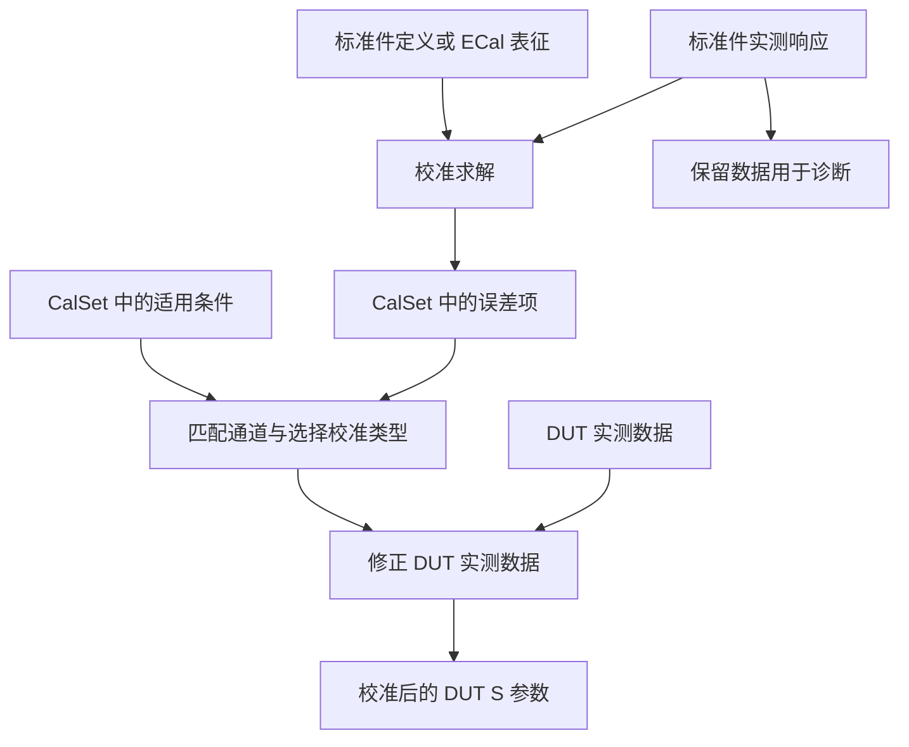

# Keysight VNA CalSet 内容及用途说明

CalSet 是 VNA 一次校准所形成、可供测量通道调用的校准数据集。它需要让仪器知道**用哪些误差系数修正、这些系数适用于哪些测量条件、校准结果来自哪次采集**。Keysight 在公开帮助中列出了名称和描述、GUID、校准属性、标准件数据和误差项。本说明以 PNA/PNA-X 的 S 参数校准为主，用 N5247B 的四端口 `CalSet_101pts` 举例，并给出自研 VNA 的保存要求。 [Keysight Cal Sets 帮助](https://helpfiles.keysight.com/csg/e5080b/S3_Cals/Cal_Sets.htm)

# 1. CalSet 在校准和测量中的作用

**校准时**，仪器使用标准件的已知特性或校准方法给出的约束，以及本次实际测得的响应，求得系统误差项。**应用时**，仪器根据端口、频率轴和校准类型选择已求得的误差项，并修正后续 DUT 测量。**诊断时**，可以分别查看标准件采集曲线和误差项曲线，定位异常更可能发生在采集还是求解环节。 [Keysight Cal Set Viewer](https://helpfiles.keysight.com/csg/NA520xA/S3_Cals/Errors.htm)

# 2. 保存内容与用途

| 内容 | 需要保存的字段 | 用途 |
| --- | --- | --- |
| **校准结果** | 每条误差项的标识、适用端口或源端口与接收端口、频点及复数系数。按方法附带所需参考归一化数据 | 补偿系统的方向性、源匹配、负载匹配和反射或传输跟踪等系统误差。误差项标识和端口方向决定系数用于哪条测量路径 |
| **校准范围与参考条件** | 校准类型、覆盖端口及支持的传输方向、频率轴、参考阻抗，必要时关联参考面配置 | 判断当前通道中的每个测量能获得何种修正。相同的频率和端口编号仍需对应实际校准时的参考面和物理连接 |
| **测量配置** | 扫频类型、激励功率、IF 带宽、衰减器和相关测试路径状态，按功能保存决定校准适用性的设置 | 支持恢复采集条件、比较当前通道设置，以及判断是否可沿用校准、插值或降低修正级别 |
| **标准件与校准过程记录** | 逐端口连接器和校准件、ECal 表征选择、端口映射、标准状态或步骤号、Thru 端口对和所用方法 | 明确每次采集对应哪个标准状态、端口及连接关系。用于排查校准件选错、接线错误或步骤异常 |
| **标准件实测数据** | 反射与直通的复数迹线，方法需要时附参考接收机比值或其他输入。每条迹线关联频率轴、测量步骤、端口和激励方向 | 检查接触不良、随机噪声、漂移和重复性。具备完整的求解输入时，可用于离线复算和算法对比 |
| **身份和追溯信息** | 名称、GUID、描述、采集时间、仪器型号与序列号、固件版本 | 识别校准记录，确认它由哪台仪器和哪个版本生成，支持历史故障追溯和结果对比 |

一个 CalSet 可以包含一种或多种适用的校准类型。比如只具备 Port 1 一端口校准的 CalSet，可以为 S11 提供反射修正，而 S21 需要连接两个端口的传输校准数据。频率轴相同时，可按原频点应用。频率在范围内但点位不同时，要根据校准类型、测量模式和插值设置判断。测试电缆移动、参考面改变或测试路径切换时，还需检查实际连接和路径是否与校准时一致。 [Keysight CalSet 应用命令](https://helpfiles.keysight.com/csg/NA520xA/Programming/GP-IB_Command_Finder/Sense/CorrCset.htm) · [误差修正与插值](https://helpfiles.keysight.com/csg/NA520xA/S3_Cals/Error_Correction_and_Interpolation.htm)

# 3. 三类数据如何区分

| 数据 | 它回答的问题 | 在四端口 ECal 中的例子 |
| --- | --- | --- |
| **标准件定义或 ECal 表征** | 这个标准件状态的电气特性是什么 | ECal 模块某反射状态的表征值，或 Unknown Thru 所需的互易约束与延时信息 |
| **标准件实测数据** | 本次用这台 VNA 实际测到了什么 | Port 1 接入某个 ECal 反射状态时测得的复数 S11，以及给求解器使用的对应记录 |
| **误差项** | VNA 测量系统的误差应如何补偿 | 用多个标准状态求得 Port 1 的方向性、源匹配和反射跟踪，再用这些系数修正后续 DUT 的 S11 |

方向性描述反射通道在理想匹配情况下仍可能出现的泄漏，源匹配描述测试端口与标准件或 DUT 之间的再反射，反射跟踪描述反射测量链路的幅相响应。三者都随频率变化。一个标准状态的一条 S11 实测曲线只是求解输入之一。Keysight 的校准件文档描述标准件定义，Cal Set Viewer 的 **Standards** 显示标准件实测数据，**Error Terms** 显示求解后的系数。 [标准件定义](https://helpfiles.keysight.com/csg/NA520xA/S3_Cals/Standards_Tab.htm) · [Unknown Thru 方法](https://helpfiles.keysight.com/csg/NA520xA/S3_Cals/Calibration_THRU_Methods.htm) · [误差项与标准件查看](https://helpfiles.keysight.com/csg/NA520xA/S3_Cals/Errors.htm)

# 4. 四端口样本确认的内容

| 样本中可以确认 | 可以用于验证 |
| --- | --- |
| Port 1–4，10 MHz–1 GHz，101 点，参考阻抗均为 50 Ω | 校准的端口与频率覆盖，以及参考阻抗 |
| 两套标准件迹线索引，各 46 条。对应迹线复数值相同，分别按采集步骤和求解器键名索引 | 从采集记录追踪到求解输入。两套索引可指向同一份实际测量数据 |
| ECal 校准件记录、Thru 端口对 1–2、1–3、1–4，以及对应的 Unknown Thru 延时字段 | 核对校准拓扑及求解使用的直通相关输入 |
| 24 条各 101 点的复数误差项数组 | 按频点与仪器导出的命名误差项曲线做比对 |

样本中 24 条数组的物理名称及端口方向仍待仪器对照。样本记录了 ECal 校准件信息，完整的 ECal 表征数据是否一同保存在该 CalSet 中仍待确认。仪器端可通过 `SENSe:CORRection:CSET:ETERm:CATalog?` 枚举误差项，并用 `SENSe:CORRection:CSET:ETERm?` 按目录返回的完整名称取数。用同一份校准的数据逐条比较频率轴、实部和虚部，可以建立文件数组与仪器命名误差项的对应关系。 [样本观察记录](pna-cal-file-format.md) · [Keysight CalSet SCPI](https://helpfiles.keysight.com/csg/NA520xA/Programming/GP-IB_Command_Finder/Sense/CorrCset.htm)

# 5. 自研 VNA 的保存要求

1. **支持重新应用校准。** 保存可直接应用的命名误差项、频率轴、端口及方向、校准类型、参考阻抗和足以判断适用性的测量配置。把名称、唯一标识和采集时间与结果绑定，方便通道选择和后续追溯。

2. **支持校准诊断。** 保存标准件迹线、校准步骤、标准状态、端口映射和直通连接关系。原始采集键与求解器键可用两套索引关联同一条迹线。问题复盘时能从异常系数追溯到相应的输入曲线。

3. **支持离线复算。** 在诊断数据基础上，保存参与计算的标准件定义或可按版本精确取回的引用，并保留校准方法、算法版本、影响结果的选项和中间输入。例如 Unknown Thru 延时、参考接收机比值等应按所用方法保留。这样才能用同一批输入复算自身误差项，或与 Keysight 的结果逐项对比。

4. **支持其他校准类型。** 当执行了源功率或接收机功率校准等扩展校准时，分别标识其系数、适用端口与频率范围。通道应能够判断哪些修正能力可用。 [Keysight 修正级别与接收机功率校准](https://helpfiles.keysight.com/csg/NA520xA/S3_Cals/Error_Correction_and_Interpolation.htm)

对当前对比工作，优先验收两件事。第一，导入和重新应用后，同一通道条件下能复现原来的 DUT 修正结果。第二，给定同一组标准件实测和标准件定义，离线求解能复现对应的误差项。前一项验证保存与应用，后一项验证校准算法。
